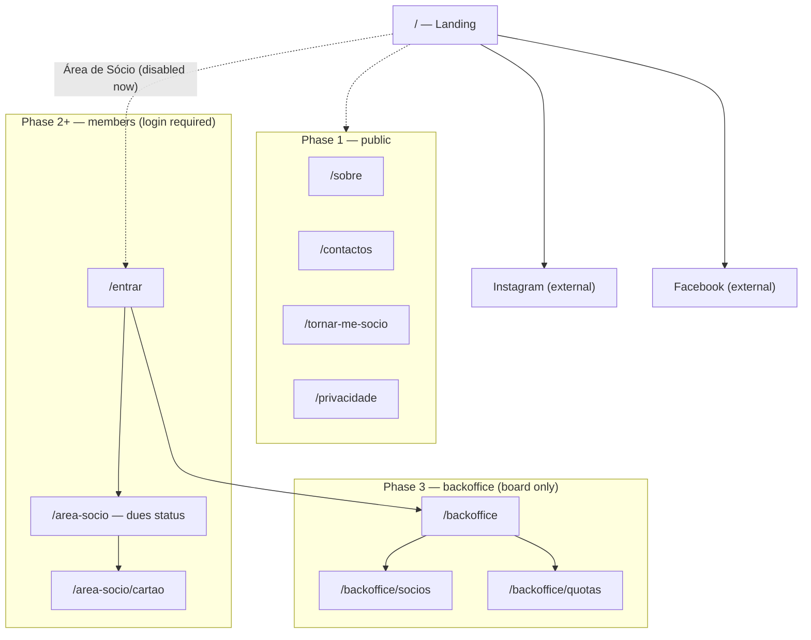
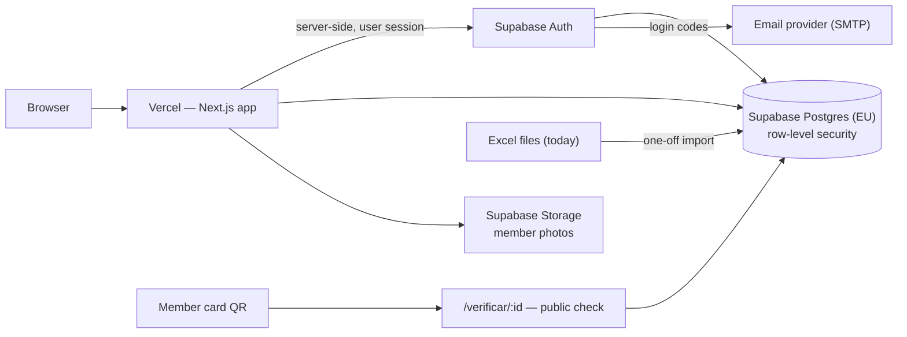

# A Quadrada — Agremiação Copofónica e Desportiva — Website

Source of truth for what this site is, where it's going, and why decisions were made.
Update it in the same commit as any change to scope, structure, or a decision.

## Vision

Public face of the association, which grows into a **members' portal**: every member
(sócio) logs in to see their digital member card and dues status (paid up to which month),
and selected members (board/treasurer) get a **backoffice** to manage members and payments.

- Language: Portuguese (pt-PT). All UI copy in pt-PT.
- Official name: **A Quadrada — Agremiação Copofónica e Desportiva** ("A Quadrada" for short;
  Instagram `@quadrada.acd`). Copy lives in `src/config/site.ts`.
- Brand colour: **orange** from the logo (`#f57215`), now and in all future work. Green and red
  from the logo's ribbons are accents for decoration only.
- Logo: original in `brand/q_quadrada.png`; web versions (badge medallion, Q shield, favicon,
  share image) are generated by `python3 scripts/build_brand_assets.py`. Never edit them by hand.
- Audience: current members, prospective members, general public.
- Today, dues are tracked in **Excel**; those files seed the members database (phase 2).

## Roadmap

| Phase                    | Scope                                                                                                                                            | Status          |
| ------------------------ | ------------------------------------------------------------------------------------------------------------------------------------------------ | --------------- |
| 0 — Landing              | Header with brand + disabled "Área de Sócio" and "Brevemente disponível para sócios"; two square tiles linking to Instagram and Facebook; footer | **Done**        |
| 1 — Public info          | About us, contacts, events/news, how to become a member, privacy policy                                                                          | Proposed        |
| 2 — Members data & login | Supabase project, schema, Excel import, member login (email code), dues status page                                                              | Next major step |
| 3 — Backoffice           | Board/treasurer screens: manage members, record payments, export                                                                                 | Planned         |
| 4 — Member card          | Digital card (member number, name, photo, validity, QR code); optional Apple/Google Wallet                                                       | Planned         |
| 5 — Member content       | Documents, discounts, event sign-up; online dues payment (MB WAY / Multibanco)                                                                   | Idea            |

## Decisions

Each decision has a short record in [`decisions/`](decisions/). Change a decision by adding a
new record that supersedes the old one, never by editing history.

| #                                               | Decision                                                      | Status   |
| ----------------------------------------------- | ------------------------------------------------------------- | -------- |
| [0001](decisions/0001-nextjs-framework.md)      | Next.js (App Router, TypeScript) as the framework             | Accepted |
| [0002](decisions/0002-supabase-backend.md)      | Supabase for login, database and file storage (EU region)     | Accepted |
| [0003](decisions/0003-vercel-hosting.md)        | Vercel hosting; Hobby now, Pro when the members area launches | Accepted |
| [0004](decisions/0004-styling-and-brand.md)     | CSS Modules + design tokens, orange brand, self-hosted font   | Accepted |
| [0005](decisions/0005-member-login-and-dues.md) | Email-code login; dues computed from payments; Excel import   | Proposed |
| [0006](decisions/0006-dynamic-qr-code.md)       | Dynamic QR code via our own `/qr` redirect                    | Accepted |
| [0007](decisions/0007-own-domain.md)            | Own domain `quadradaacd.com`; printed QR codes use it         | Accepted |

## Site map



## Architecture



### Core data (draft)

- `members` — id, member_number, name, email, photo, joined_at, status.
- `payments` — member_id, period (month), amount, paid_at, method, recorded_by.
- `roles` — which users are `admin` (backoffice access).
- "Paid up to" = latest consecutive paid month, computed from `payments`, never typed by hand.
- Members see only their own rows; admins manage all. Enforced in the database (RLS), not only in the UI.

## Code structure

```
src/
  app/                    routes (Next.js App Router)
    layout.tsx            html shell, metadata, header + footer
    page.tsx              landing page
    not-found.tsx         pt-PT 404
    globals.css           design tokens + base styles
    icon.png, apple-icon.png, opengraph-image.png   generated from the logo
  assets/brand/           generated logo files (badge, shield)
  components/             shared UI, one folder per component (+ .module.css)
  config/site.ts          name, description, social links: single source of truth
brand/                    original logo files (source of truth)
scripts/                  build_brand_assets.py
docs/                     this plan + decision records
.github/workflows/ci.yml  format, lint, typecheck, build on every PR/push
```

Planned additions, created only when the phase needs them:

- `src/app/(public)/…` and `src/app/(members)/…` route groups, `src/app/backoffice/…` (phases 1–3).
- `src/lib/supabase/` — server and browser clients (phase 2).
- `supabase/migrations/` — SQL schema and RLS policies, versioned in git (phase 2).
- `scripts/import-excel` — one-off import of the current Excel files (phase 2).
- `.env.example` — variable names only; real values in Vercel and a git-ignored `.env.local`.
- Tests: Vitest for logic (e.g. "paid up to"), Playwright for login/backoffice flows (phase 2).

## UI guidelines

- Mobile-first, checked at 320px, 375px and desktop; social tiles stay side by side as squares.
- Accessibility: semantic landmarks, `lang="pt-PT"`, visible `:focus-visible` rings,
  external links announce "(abre numa nova janela)", WCAG AA contrast, respects
  `prefers-reduced-motion` and `prefers-color-scheme`.
- All colours, spacing, radii and shadows come from tokens in `globals.css`.
- Features not yet available are shown **disabled** with an explanation, never as dead links.
- Hero: logo badge (gentle wobble on hover), name and full name, social tiles. Background is a
  soft orange glow + floating squares (nod to "Quadrada"), two of them in the logo's ribbon
  green/red. To be combined with real member photos when available.

## Open questions / needed from the association

- [x] Real Instagram and Facebook URLs (in `src/config/site.ts`).
- [x] Official name: A Quadrada — Agremiação Copofónica e Desportiva.
- [ ] Short description of what the association does and where (for an "about" section).
- [x] Logo (PNG). An SVG version would give sharper edges at every size, if one exists.
- [ ] Hero photos of members/activities (landscape, ≥2000px wide, with consent of people shown).
- [ ] Public contact email / address / NIF for the footer.
- [x] Domain: `quadradaacd.com` (GoDaddy, auto-renew). Print QR: `brand/qr/` → `https://quadradaacd.com/qr`.
- [ ] Excel files (phase 2): columns used, number of members, monthly or annual dues.
- [ ] Who gets backoffice access, and what each of them can change.

## GDPR (RGPD) notes for phase 2+

Member data is personal data: need a privacy policy, a legal basis (membership contract),
data minimisation, EU data residency, and a way for members to export or delete their data.
Card photos and QR codes must not expose more than the member number + validity publicly.
The Excel files contain personal data: share them privately, never commit them to git.
